# teamcity-platform

Jenkins-style auto-discovery for TeamCity. An application is onboarded with one reviewed entry in `Catalog.kt`.
After that, its repos are found in Azure DevOps and get build and deploy pipelines without anyone touching TeamCity.

Details: [repo-contract.md](repo-contract.md) (for app developers) · [design.md](design.md) (rationale) ·
[README](../README.md) (setup and operations).

## How it works

```mermaid
flowchart LR
    subgraph SRC["Source (people)"]
        CAT["Catalog.kt<br/><small>BU → app → ADO project</small>"]
        ADO["ADO repos<br/><small>ci.yaml or FA- / WA-</small>"]
    end

    subgraph JOBS["Platform jobs"]
        BOOT["Bootstrap Apps<br/><small>on Catalog.kt merge</small>"]
        DISC["Discover Repos<br/><small>every 30 min · fail-static</small>"]
    end

    subgraph RES["Result"]
        PROJ["&lt;BU&gt; / &lt;App&gt; project<br/><small>context app=&lt;bu&gt;/&lt;app&gt;</small>"]
        LIST["repos/&lt;bu&gt;/&lt;app&gt;.txt<br/><small>committed + pushed</small>"]
    end

    DSL["Kotlin DSL regenerates the app<br/><small>Build/&lt;type&gt;/&lt;repo&gt;<br/>Deploy/&lt;ENV&gt;/&lt;repo&gt; · Deploy all</small>"]

    CAT --> BOOT --> PROJ --> DSL
    ADO --> DISC --> LIST --> DSL

    subgraph GEN["Generated per repo: build once, deploy many"]
        direction LR
        BUILD["Build &lt;repo&gt;<br/><small>every branch + PR</small>"]
        DEV["Deploy DEV<br/><small>auto, default branch</small>"]
        HIGHER["Deploy INT · QA · PROD<br/><small>default branch only</small>"]
        AZ["Azure Function App<br/><small>&lt;azure_name&gt;-&lt;env&gt;</small>"]
        BUILD -- app.zip --> DEV -- same zip --> HIGHER -- deploy --> AZ
    end

    DSL -- generates --> BUILD

    classDef human stroke:#a85d0c,stroke-width:2px
    classDef auto stroke:#0d6b71,stroke-width:2px
    classDef gen stroke-dasharray:5 4
    class CAT,ADO human
    class BOOT,DISC,DSL auto
    class BUILD,DEV,HIGHER gen
```



Amber outline: edited by people. Teal outline: automated by the platform. Dashed: generated in TeamCity.

- **Level 1, applications.** People curate `Catalog.kt` through PRs. Merging triggers **Bootstrap Apps**, which creates the TeamCity project, points its versioned settings at this repo and sets `app=<bu>/<app>`.
- **Level 2, repos.** **Discover Repos** scans each application's ADO project every 30 minutes, classifies each repo, and commits the list. If ADO can't be reached, it keeps the previous list.
- **One repo, many projects.** Every application project loads the same DSL. The `app` context parameter decides what gets generated, so a broken definition only breaks that one application.

## Day to day

| I want to… | Do this |
|---|---|
| Onboard an application | PR an `AppSpec` into `Catalog.kt`. After the merge, Bootstrap and Discover run and the application is ready. |
| Add a repo | Create it in the application's ADO project with a `ci.yaml` (or an `FA-` / `WA-` name). It appears within about 30 minutes. |
| Remove a repo | Disable or delete it in ADO, or set `enabled: false`. Its configs are removed on the next run. |
| Change every deploy | PR to `Templates.kt`. *Validate DSL* compiles every application before the merge. |
| Restrict PROD | Assign TeamCity roles on `<App> / Deploy / PROD`. |

## The repo contract

If you own a Function App or Web App repo, these rules are all you need. Follow them and your pipelines create themselves.

1. **One repo, one deployable.** Add more functions inside the same Function App. Put a separate Function App in its own repo.
2. **The app lives at the repo root.** `host.json` goes at the top level. Without `ci/build.sh`, the platform zips the repo root.
3. **Declare the repo in `ci.yaml`.** It's explicit and takes priority over the name prefix.
4. **No secrets in the repo.** Keep `local.settings.json` gitignored, and put settings on the Azure resource or in Key Vault.
5. **Code shared between apps goes in a versioned package** (Azure Artifacts), never in copied folders.

```
FA-orders/
├── ci.yaml
├── ci/
│   ├── test.sh      # optional, executable
│   └── build.sh     # must produce app.zip
├── host.json        # Function App root
├── function_app.py
├── orders/          # blueprints / modules
├── shared/          # this app only
├── requirements.txt
├── tests/           # never packaged
└── .gitignore       # local.settings.json
```

```yaml
# ci.yaml
type: function-app        # function-app | web-app
azure_name: func-orders   # → func-orders-dev, -prod …
# enabled: false          # take repo off the platform
```

| Stack | Needs `ci/build.sh`? | How it deploys |
|---|---|---|
| Python (v2) | No | `requirements.txt` in the zip makes Azure run a remote build. |
| Node.js (JS) | No | `package.json` in the zip makes Azure run a remote build. |
| TypeScript | Yes | `npm ci && npm run build`, then zip `host.json`, `dist`, `package.json` and `node_modules`. |
| .NET isolated | Yes | `dotnet publish -o out`, then zip `out/`. It's deployed as-is, with no remote build. |

> **Watch what gets packaged.** Without `ci/build.sh`, the platform excludes only
> `.git/ .teamcity/ ci/ tests/ .venv/ node_modules/.cache/ local.settings.json ci.yaml`.
> `README.md`, `docs/`, `infra/` and `.github/` are shipped to production, and `.funcignore` is ignored.

## Why one Function App per repo

**The repo is the unit of discovery.** Each discovered repo becomes one build and one deploy per environment.
Keeping one deployable per repo means a new repo needs nothing but `ci.yaml`, its classification is clear, and
triggers, policies, rollback and blast radius all stay per app.

**It matches how Azure deploys.** Microsoft treats the function app as the unit of deployment: all of its functions
ship together from one package. Microsoft does not tell you to use one repo per function app. That is our own
decision, which keeps the deployment unit and the discovery unit the same. It also lines up with Twelve-Factor's
one codebase per app.

**What it costs:** more repos, shared code published as packages, and changes that span apps take several PRs. If
several repos always change together, they probably belong in one Function App. Monorepo support (a list of `apps`
in `ci.yaml`, with path-filtered triggers) is possible, but it will be built only when a team needs it.

## Patterns it follows

| Pattern | Where it shows up |
|---|---|
| Golden path | `Templates.kt` has one supported pipeline per app type. |
| Convention over configuration | Prefixes and `ci.yaml` choose the template, with no setup per repo. |
| Organization-folder discovery | The platform scans the ADO organization and creates jobs for repos that match. |
| Config as code, PR as control plane | The catalog and DSL are reviewed in git, and editing in the UI is off. |
| Build once, deploy many | One `app.zip` is promoted through every environment. |
| Reconciliation, fail-static | Discovery brings TeamCity in line with ADO and keeps the last known state if the API fails. |
| Strangler fig | New apps go on the platform. Legacy apps migrate one whole application at a time. |

## Known limitations

| | Limitation |
|---|---|
| Gap | **Promotion order isn't enforced.** A default-branch build can deploy straight to PROD. For now, restrict PROD with TeamCity roles. |
| Gap | **Removed repos are deleted, not archived.** Their configs disappear on the next discovery run. |
| Gap | **Fixed packaging excludes.** `.funcignore` isn't honoured yet. |
| Gap | **Templates aren't versioned.** A change reaches every application at once. Publishing them as a Maven library is on the roadmap. |
| Verify | **Not yet run against a live server.** The Kotlin DSL compile and the bootstrap REST endpoints (TeamCity 2023.05+) still need checking. |

## References

- [Azure Functions best practices](https://learn.microsoft.com/en-us/azure/azure-functions/functions-best-practices), the "Organize your functions" section
- [Deployment technologies in Azure Functions](https://learn.microsoft.com/en-us/azure/azure-functions/functions-deployment-technologies)
- [Azure Functions deployment slots](https://learn.microsoft.com/en-us/azure/azure-functions/functions-deployment-slots)
- [Well-Architected Framework: Azure Functions](https://learn.microsoft.com/en-us/azure/well-architected/service-guides/azure-functions)
- [The Twelve-Factor App: I. Codebase](https://12factor.net/codebase)
- [Strangler Fig Application](https://martinfowler.com/bliki/StranglerFigApplication.html) (Martin Fowler)
